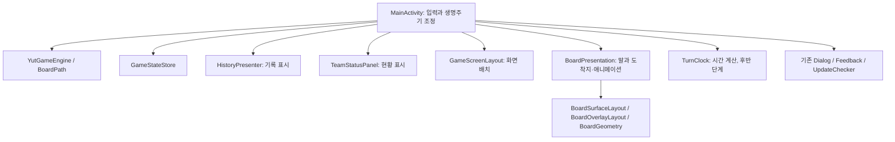

# 빌드 66 구조 분리 설계

작성: 2026-10-06 / Codex / C:\yutnori

상태: **구조 설계 완료, 구현 전**. 기준 소스 `9eae39f6f97d3aceec90f8cb4dcd220daaf4c45c`, 태그 `baseline-build66`, 앱 `1.5.12 / 66`.
설계 브랜치: `design/refactoring-build66`. [기능 유지 계약과 측정 기준](refactoring-baseline-66.md)을 함께 적용한다.

## 1. 결정

Java와 기존 Android View/XML 구조를 유지한다. `MainActivity`에서 화면 표시 책임을 작은 단위로 분리한 뒤, 타이머와 반복 작업을 별도 단계에서 다룬다. 엔진·경로·저장 형식은 이번 구조 분리의 변경 대상이 아니다.

사용자가 성공 기준으로 지정한 것은 **지금 가능한 모든 게임 조작과 저장 게임을 그대로 사용할 수 있는 것**이다. 파일 수나 줄 수를 줄이는 것보다 기능 동등성이 우선한다. 온라인·사진 꾸미기 등 2.0 기능, UI 재설계, 라이브러리·SDK 업그레이드는 이 작업에 포함하지 않는다.

현재 게임 규모에는 새 프레임워크, 의존성 주입 컨테이너, 이벤트 버스, ViewModel 전환을 함께 도입할 근거가 부족하다. 기존 package 안에 필요한 구체 클래스만 추가한다. 상태를 전달하기 위해 매 프레임 전체 게임을 복제하지 않는다.

## 2. 실제 소스에서 확인한 구조

아래 줄 번호는 기준 소스에 대한 탐색 위치다. 구현 후에는 메서드 이름과 기준 커밋을 함께 확인한다.

| 현재 책임 | 근거 | 설계상 의미 |
| --- | --- | --- |
| 순수 규칙·경로 | `YutGameEngine`, `BoardPath`, `Piece` | Android UI 없이 분리돼 있으므로 유지 |
| Activity 생명주기·재배치 | `MainActivity` 165~357, `onConfigurationChanged` | 회전은 Activity를 유지한 채 XML을 다시 생성하며, 별도로 Activity 재생성도 지원 |
| 현황·대기 말 | `buildTeamAreas` 816, `updateFinishedSummary` 868, `rebuildCurrentWaitingArea` 943 | 현황판 아이콘과 실제 움직이는 말은 다른 View; 소유자를 구분해야 함 |
| 입력·취소·시간·기록 통합 | `handleYutInput` 979, `undoLastMove` 1061, `commitSelectedMove` 1296 | 게임을 바꾸는 순서는 당분간 Activity에 모아 유지 |
| 논리 상태 선확정 | `applyMoveResult` 1319, `cancelMovePresentation` 1375 | 이미 이동 효과·시간·승리 대기를 저장한 뒤 애니메이션 시작; 반드시 유지 |
| 말·도착지·안내 표시 | `animateMoveResult` 1478, `renderBoardPiecesNow` 1833, `updateMovePreviews` 1983 | 동일 View와 세대 번호를 공유하므로 표시와 애니메이션을 함께 소유 |
| 가로 배치·패널·안전 여백 | `applyEdgePanelState` 2419, `bindSafeAreaInsets` 2707, `updateUnlimitedControls` 3886 | XML 요소를 실제로 부모 간 이동시킴. 단순 크기 계산 함수만 옮겨서는 분리되지 않음 |
| 기록 표시 | `updateActionLogRail` 2952, `formatMoveLog` 3124 | 엔진 변경과 독립적이므로 첫 추출 후보 |
| 저장·복원 | `persistGameState` 3402, `GameStateStore.save/restoreAppState` | Activity 상태와 엔진 상태를 함께 저장; 키·기본값·호환 처리를 유지 |
| 타이머 | `syncTimerToNow` 3618, `updateTimerView` 3632 | 매 시간 표시 갱신이 `updateTimerLayout`까지 호출됨. 성능 측정 후보 |
| 역방향 취소 | `recordReversePaths` 3689, `animateUndo` 3720 | 논리 복원 후 역경로만 표시. 취소 대기열과 표시 중단을 함께 검증 |

`MainActivity`는 빈 줄 포함 4,094줄이다. 단순히 클래스 하나를 크게 나누는 것보다, 위 책임별 쓰기 권한과 생명주기를 정하는 것이 필요하다.

### 기존 동작을 잘못 해석하지 않기

- 빌드 66의 현황판은 게임 중 항상 보인다. **세로에서 입력 패널을 접고 펼치며, 가로에서는 컨트롤이 고정**된다. 옛 대화의 양쪽 접기 요구를 리팩토링에 다시 넣지 않는다.
- `unlimited*`라는 이름의 여러 메서드·View는 현재 가로 시간전에도 사용된다. 이름 변경은 관련 코드 이동과 구분하며, 리소스 ID는 유지한다.
- 현재 다시하기와 나가기는 별도 버튼이다. 다시하기는 팀·꾸미기·규칙·제한 시간을 유지하고 게임을 초기화하며, 나가기는 팀 선택 화면으로 간다.
- 백업은 `yutnori_state` 저장소와 schema 1을 사용한다. 화면 방향은 별도 `yutnori_display` 설정이므로 백업 범위를 임의로 확대하지 않는다.
- 새 게임의 잡기 중복 보너스 기본값과 오래된 저장 게임의 기본값이 다르다. `captureBonusStacks`의 호환 기본값을 통일하지 않는다.
- 시간 변경·자동 시간 초과는 취소 기록을 비우지만, 수동 턴 종료는 취소할 수 있다. 시간 멈춤은 말 조작을 막는 전체 게임 정지가 아니다.

## 3. 목표 구조와 소유권

화면의 클릭은 Activity에 의도를 전달하고, Activity가 기존 검증·엔진 호출·저장 순서를 수행한다. 표시 객체는 엔진에 이동·턴 종료·저장 명령을 내리지 않는다. 동기화 대상이 적은 현재 앱에는 별도의 전역 세션 관리자를 추가하지 않는다.

| 객체 | 소유할 내용 | 소유하지 않을 내용 / 경계 |
| --- | --- | --- |
| `MainActivity` | 엔진 인스턴스, 선택한 말, 팀 꾸미기, 게임 시작·승리 대기, 취소 이력, 기록 원본, 사용자 명령 순서, 저장·다이얼로그 조정 | 다른 객체와 같은 상태를 각각 수정하는 복제 필드 금지 |
| `HistoryPresenter` | 기록 문자열 포맷과 최근 기록 아이콘·색·접근성 설명·표시 애니메이션 | 기록 추가·삭제·최대 200개 제한·저장·다이얼로그 시간 보류는 Activity |
| `TeamStatusPanel` | 현황 행/아이콘, 현재 팀 색·모양, 골인 X 상태, 2/3/4팀 중앙 정렬과 행 높이 | 실제 움직이는 `pieceViews`와 대기 칸은 여기로 옮기지 않음 |
| `GameScreenLayout` | 현재 root와 패널 참조, 가로 컨트롤 부착 여부, 크기·폰트·insets 반영, ConstraintSet, 패널 전환·레이아웃 예약 | 엔진 상태·시간 차감·말의 논리 위치·게임 진행 금지 |
| `BoardPresentation` | 실제 말과 대기 칸, 그룹 표시, 선택 강조·도착지·안내, 정방향/역방향·잡기·골인 애니메이션과 임시 View, 표시 취소 | 엔진·취소 이력·남은 시간·승리 확정은 Activity가 담당 |
| `TurnClock` | 후반 단계에서 남은 시간·단조 시각 체크포인트·수동 정지·표시/창 보류 계산 | Handler, View, 저장소, 강제 턴 종료 명령은 소유하지 않음 |

엔진 조회를 필요로 하는 표시 객체에는 우선 기존 조회 API와 색·모양을 전달한다. 엔진의 `getPiece/getPieces`는 가변 객체를 반환하므로 조회 결과를 수정하지 않는지 코드 검토한다. 비동기 표시용 경로는 확정된 `MoveResult`와 역경로를 사용하고, 오래 보관할 배열은 방어 복사한다.

### 클래스 사이의 작은 계약

이름과 메서드 모양은 구현 시 실제 의존성에 맞추되 다음 범위를 넘기지 않는다.

- `HistoryPresenter.render(...)`: 최신 기록·팀 표시 정보·콤팩트 여부를 받아 표시. 클릭 콜백은 `onOpenHistory`, `onOpenEntry(index)`만 제공한다.
- `TeamStatusPanel.render(...)` / `resizeRows()`: 현재 팀·완주 상태와 실측 현황 영역을 반영한다. 별도 점수나 완주 상태를 저장하지 않는다.
- `GameScreenLayout.attach(...)` / `apply(...)` / `dispose()`: 새 XML root에 한 번 연결한다. 배치 후 최신 영역으로 다시 그려야 한다는 콜백만 Activity에 전달한다.
- `BoardPresentation.render(...)` / `playMove(...)` / `playUndo(...)` / `cancel()` / `dispose()`: 이동/취소 완료 또는 취소를 알린다. 칸 클릭은 팀·말/도착 선택 의도로 전달한다.
- `TurnClock.sync(now, runConditions)` 등은 가짜 시각으로 검증 가능하게 한다. 시간 초과를 알리면 Activity가 기존 조건 확인 후 한 번만 턴을 끝낸다.

모든 Presenter가 MainActivity 전체를 받아 private 메서드에 접근하게 만드는 방식은 피한다. Android View용 Context와 꼭 필요한 콜백만 전달한다. 클래스 간에는 서로의 필드나 View를 직접 변경하지 않는다. 공유가 필요한 패널 View는 생성 시 주입하고, **부모 이동·외곽 크기는 Layout, 내부 말 표시·터치는 BoardPresentation**으로 쓰기 권한을 정한다.

## 4. 회전·애니메이션·저장 규약

### 수명 구분

- 게임 수명: 엔진·취소 이력·타이머·선택·꾸미기. 회전으로 XML만 교체될 때 유지한다.
- 화면 수명: XML root, 동적 컨트롤, 표시 객체와 리스너. root 교체 때 모두 다시 연결한다.
- 표시 작업 수명: 한 번의 이동/취소/안내/패널 전환. 취소 또는 완료 후 폐기한다.
- Activity 자체 재생성: 기존 저장 형식으로 게임을 복원하고 Bundle의 입력 패널 상태·꾸미기 초안을 복원한다. 화면 객체를 static 필드에 보관하지 않는다.

Activity는 화면 세대 번호를 관리한다. 각 표시 객체는 작업 세대 번호 또는 동등한 취소 토큰을 관리하며, 예약 콜백은 **화면 세대와 해당 작업의 유효성**을 확인한다. 현재의 `layoutGeneration` 등 여러 카운터는 처음 옮길 때 동일 역할을 유지한다. 토큰 체계 통합은 별도 검증 후 수행한다.

### 이동 확정 순서

1. 입력 허용과 시간 초과를 확인하고 취소용 이전 상태를 얻는다.
2. 엔진 이동을 한 번 호출한다. 실패 시 기존 오류 안내만 표시한다.
3. 성공하면 역경로·취소 이력·기록·다음 턴 시간/잡기 보너스·승리 대기를 반영한다.
4. 선택을 정리하고 표시 중 입력/시간 보류를 적용한 상태를 저장한다.
5. 확정된 결과를 애니메이션으로 표시한다. 완료 후 화면·입력·시간 보류·승리 안내를 갱신한다.

애니메이션 완료 콜백에서 엔진 이동이나 보너스를 다시 적용하지 않는다. 애니메이션이 생략되는 설정도 같은 최종 상태가 되어야 한다.

### 회전 또는 크기 변경 순서

1. 현재 시각까지 시간을 정산한다.
2. 이전 표시 작업을 무효화한 후 Animator를 취소한다. 취소가 end 콜백을 유발해도 게임 진행을 다시 수행하지 않는다.
3. 임시 말·잔상·안내와 오래된 화면의 예약 작업/리스너를 정리한다. XML 교체 시 표시 객체도 폐기한다.
4. 현재 방향 root를 연결하고 실제 layout이 끝난 후 논리 노드로 말과 화살표를 배치한다.
5. 보류를 해제하고 현재 게임 상태로 입력·시간·승리 안내를 복원한다.

좌표의 기준은 기존 `BoardSurfaceLayout`의 정사각형 표시 영역과 `BoardOverlayLayout.centerForSpot`이다. 말·화살표의 픽셀 좌표를 저장하거나 회전 전 좌표에 비율을 곱해 복원하지 않는다. 대기 칸·골인 칸을 오가는 루트 오버레이의 좌표 변환은 별도로 유지한다. 화면 크기가 0일 때 임의 좌표를 저장하지 않는다.

`dispose()`는 해당 객체가 등록한 리스너/예약 작업만 제거한다. 다른 기능의 Handler 콜백을 한꺼번에 지우지 않는다. 중첩 설정창, 시간 정지, 표시 보류는 각각 구분하고 보류 해제로 사용자의 수동 시간 정지까지 해제하지 않는다.

## 5. 실행 순서와 완료 조건

각 행을 별도 커밋 가능한 묶음으로 처리한다. 구조 이동과 성능 최적화는 서로 다른 변경으로 비교한다.

| 단계 | 구현 범위 | 먼저 확보할 검증 | 완료 조건 |
| --- | --- | --- | --- |
| A | 기록 표시/포맷을 `HistoryPresenter`로 추출 | 빈 기록, 최신 기록 클릭, 한국어·영어, 팀 색, 취소·복원 후 기록 | 문자열·순서·아이콘·색·클릭 결과 유지, 게임 상태 변경 없음 |
| B | 현황판을 `TeamStatusPanel`로 추출 | 기존 2/3/4팀 정렬, 현재 팀 모양, X 대비, 4팀 버튼 겹침 테스트 | 현황 표시·접근성 설명·작은 화면 배치 동일 |
| C | 가로 배치·패널·insets를 `GameScreenLayout`로 추출 | 양방향 반복 회전, 세로 접기, 카메라 좌우, 큰 폰트, 시간전↔무제한, 태블릿 | 같은 View를 중복 부착하지 않음, 접기/골인 칸 변화 후 판과 터치 정렬 유지 |
| D | 말·대기 칸·안내·이동/취소 표시를 `BoardPresentation`으로 추출 | 이동 도중 회전·background, 업기/잡기/완주/승리, 취소 연타·회전, reduced motion | 표시가 끊겨도 최종 엔진·기록·시간 상태 동일, 잔상과 늦은 콜백 없음 |
| E | 시간 계산을 `TurnClock`로 추출 | 가짜 시각으로 pause/resume, 중첩 창, 표시 보류, 보너스/취소, 0초 입력 경합 | 중복 차감·중복 턴 전환 없음, 기존 저장값 호환, clock 상태 단일 소유 |
| F | 측정 후 불필요한 표시/레이아웃 갱신 축소 | 동일 release 조건의 전후 실행 및 프레임·할당 비교 | 측정 근거가 있는 개선만 반영, 기능/시각/터치 회귀 없음 |

**다음 구현은 A부터 시작한다.** A·B 완료 시 첫 검토 가능한 구조 개선 결과를 만든다. A~E 전체를 한 번에 옮기지 않는다. C·D의 기기 검증을 수행할 수 없으면 코드 자동 검증 상태와 배포 가능 상태를 구분한다.

초기에는 옮긴 private 메서드의 얇은 위임을 남겨 기존 테스트와 호출 순서를 유지할 수 있다. 테스트 도우미를 옮긴 후 불필요한 위임을 정리한다. Reflection을 깨뜨리지 않으려고 실제 상태 필드를 복제해서 유지하는 방식은 금지한다.

## 6. 테스트 계획과 부족한 근거

기준 실행 결과는 **단위/Robolectric 130개 통과, lint 오류 0·경고 44**다. 설계 작업에서는 앱을 수정하지 않았으므로 이 결과를 새 실행으로 표시하지 않는다. Android instrumented 테스트는 소스를 확인했으며 이번 설계 단계에서 실행하지 않았다.

| 위험 | 현재 관련 테스트 | 추출 전 보완 |
| --- | --- | --- |
| 경로·규칙 | `YutGameEngineTest`, `BoardPathTest` | 엔진 유지 시 기존 assertions 보존. 화면 입력과 엔진 결과 연결 확인 |
| 좌표·터치 | `BoardGeometryTest`, `BoardTouchTargetTest`, `ExampleInstrumentedTest.coordinatesTrackRenderedBoardThroughPanelsAndMidMoveRotation` | 새 화면 연결 후 오래된 예약 콜백 실행, 연속 회전+패널/골인 칸 크기 변화 |
| 이동 중 턴·승리 | `RotationStabilityTest.rotationDuringMoveKeepsNewTurnTimeAndExactlyOneHistoryEntry`, `victorySurvivesMidMoveRotationAndActivityRecreation` | 완료 콜백과 취소가 같은 프레임에 발생하는 경우, exactly-once 상태 비교 |
| 취소 | `BoardUxTest.repeatedUndoCrossesRollMoveAndTurnBoundariesAndSurvivesRecreation`, `rotationDuringUndoKeepsRestoredStateAndRemovesGhosts` | 2/3/4팀의 상대 말 잡기 취소에서 각 대기 칸으로 돌아가는 표시도 비교 |
| 저장 호환 | `GameStateStorePolicyTest`, `BoardUxTest.backupRoundTripIncludesRuleAppearanceSelectionAndUndoPaths`, `malformedBackupNeverReplacesCurrentGame` | **빌드 66이 만든 고정 JSON/Preferences fixture**를 새 코드에서 복원. 새 코드끼리의 round-trip만으로 호환 판정하지 않음 |
| 시간 | `RotationStabilityTest.stoppedActivityCannotChargeTimeWhenSavedAgain`, `undoBonusRollRemovesTime`, `BoardUxTest.activeSettingsCanSwitchBetweenTimedAndUnlimitedWithoutResettingPieces` | 가짜 시계로 pause 이유 조합, 시간 변경 전 결과 취소, 0초와 클릭 동시 처리 |
| 새 표시 객체 | `BoardUxTest`의 현재 팀·X·정렬·insets·글씨 테스트 | 기록 포맷/아이콘 분기와 클릭을 baseline 기준으로 고정 |

테스트 상당수가 `MainActivity`의 private 필드/메서드를 Reflection으로 참조한다. 추출 때 테스트의 접근 경로는 새 소유자에 맞게 바꾸되, 기대 동작과 상태 검증을 그대로 유지한다. 테스트 개수뿐 아니라 기존 시나리오가 계속 실행되는지 확인한다.

저장 fixture에는 업힌 말, 지름길 route, 복수 결과와 선택 순서, 취소 역경로, 수동 정지, 승리 대기, 색·모양을 포함한다. 개인정보 없는 재현용 상태로 만들며 저장 시각처럼 변하는 값은 따로 검증한다. 첫 화면 재표시만 확인하지 말고 복원 후 이동·취소까지 실행한다.

검토 중 `undoPoint(node, pieceId, root)`가 대기 위치를 현재 팀 기준으로 조회하는 것을 확인했다. 상대 말의 잡기 취소 표시와 연결될 가능성이 있으나 **실기기 재현 전에는 확정 버그로 취급하지 않는다**. 새 구현에서 조용히 경로를 바꾸지 말고 먼저 baseline의 재현 결과와 의도된 동작을 기록한다.

## 7. 경량화 판정

- 이미 release R8와 리소스 축소가 켜져 있다. 클래스 분리만으로 APK나 메모리가 줄어든다고 약속하지 않는다.
- 후보 1: `updateTimerView → updateTimerLayout → updateUnlimitedControls`의 반복 작업. 실제 View 재부착은 `unlimitedControlsAttached`가 막고 있으므로 매초 전체 화면을 새로 만든다고 표현하면 안 된다.
- 후보 2: `updateResultButtons`와 `updateActionLogRail`의 `removeAllViews` 후 재생성. 실제 호출 빈도와 할당을 측정한 뒤 필요한 경우 재사용한다. 버튼의 선택 순서·클릭 대상·표시 애니메이션을 유지해야 한다.
- 후보 3: 표시 크기 계산과 동일 데이터 재그리기. 무효화 조건은 root·크기·밀도·fontScale·insets·팀 수·꾸미기·시간 모드·접기·골인 칸이다. 회전 전 픽셀 좌표를 재사용하는 캐시는 만들지 않는다.
- 저장 호출 축소, undo snapshot 축소, 백업 형식 변경은 이번 최적화에서 제외한다. 취소와 복구의 정확성에 직접 영향을 준다.

전후 비교표는 APK/AAB 바이트, 시작 시간 중앙값, 동일 게임 상태의 PSS, 동일 동작의 프레임 지연, 필요 시 View 생성·할당 횟수로 작성한다. 소스 행 수는 유지보수 구조 지표로 별도 표시한다. 기기·OS·빌드 옵션·데이터·측정 횟수를 함께 기록하고 측정 잡음보다 작은 차이를 성능 개선으로 단정하지 않는다.

실기기 성능은 아직 미측정이다. 자동 테스트의 실행 시간을 앱 실행 성능으로 대신 사용하지 않는다. 개선 폭이 작더라도 책임 분리와 검증 용이성의 가치는 따로 보고한다.

## 8. 인수인계와 배포

각 단계는 개발현황 문서에 변경 책임·검증·커밋을 기록한다. 구현은 이 설계 커밋에서 별도 작업 브랜치를 만들어 진행하고 기준 태그는 이동하지 않는다. 앱 기능에 관한 의도하지 않은 차이가 확인되면 해당 묶음을 먼저 복구한다.

설계 단계에는 버전업·APK/AAB 생성이 없다. 검수 APK와 알파 AAB는 구현·회귀 검증을 마친 뒤 생성한다. 배포용 versionCode는 그때 콘솔에 이미 사용된 값보다 크게 정한다. 프로덕션 전환은 검수 이후 별도 요청에 따른다.
